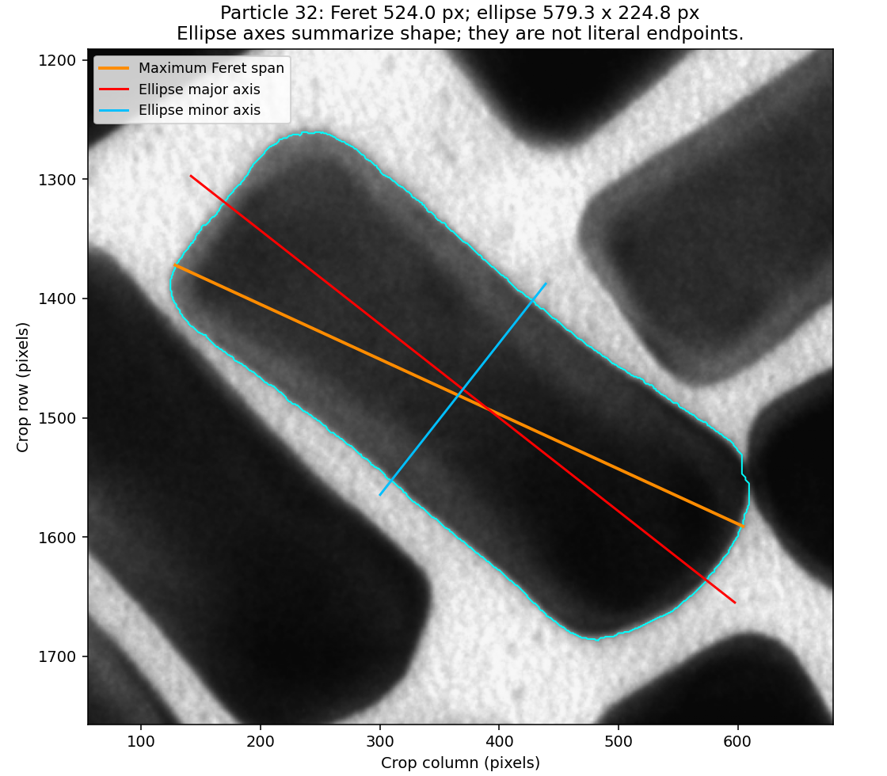

# TEM Particle Lab

A scientific Python toolkit and guided learning project for **TEM particle segmentation, manual review, size and shape measurements, spatial organisation, and exploratory tracking**.

Built with NumPy, SciPy, scikit-image, Matplotlib, tifffile and imageio. No machine learning is used.



*Experimental TEM example from Stewart and Da Silva De Sa's [PSDI dataset](https://data-collections.psdi.ac.uk/records/sgvf0-j3g53), CC BY 4.0. Orange: maximum Feret span; red/blue: moment-ellipse axes. Pixel units: calibration for this image is unverified.*

## What it does

- Segments foreground and separates proposed particles with distance-map seeds and watershed.
- Groups shallow peaks to reduce artificial divisions inside elongated rods.
- Measures area, equivalent diameter, maximum Feret span, ellipse major/minor axes, eccentricity and aspect ratio.
- Supports human review, merge/split corrections, boundary redrawing and missed-particle annotations, with versioned results.
- Compares predictions with manual references and identifies possible misses, splits and merges.
- Explores nearest-neighbour distances, pair correlations, Fourier power and centre-position structure factors.
- Demonstrates translation registration, one-template tracking, displacement, MSD and conditional error checks.
- Saves CSV measurements, diagnostic figures, settings, file hashes and local HTML reports.

## Quick start

**To analyse your own TIFF**, install the environment below, then run:

```powershell
.\.venv\Scripts\python.exe analyse_own_image.py
```

Choose a file, select its page/channel, preview the threshold and particle boundaries, optionally enter calibration, then export measurements and review results. No reference annotations are required. Native 8-bit/16-bit intensities are preserved; calibration can remain unknown. See [Your own images](YOUR_OWN_IMAGES.md) for the full workflow and scientific assumptions.

[User-image extensions](USER_IMAGE_EXTENSIONS.md) add optional noise/background preprocessing, diameter distributions, manual endpoint checks, per-image batch manifests and optional instance-reference validation. Preprocessing defaults to off; automatic and reviewed measurements remain distinct.

Use **Python 3.12**. Windows PowerShell:

```powershell
git clone https://github.com/AchillesFemto/tem-particle-lab.git
cd tem-particle-lab
python -m venv .venv
.\.venv\Scripts\python.exe -m pip install -r requirements-lock.txt
.\.venv\Scripts\python.exe -m unittest discover -s tests -v
.\.venv\Scripts\python.exe analyse.py --config analysis_config_rods_v2.json --protocol validation_protocol_rods_v2.json --skip-tracking
.\.venv\Scripts\python.exe measure_rods.py
.\.venv\Scripts\python.exe review_particles.py
```

On macOS/Linux, create the environment with `python3 -m venv .venv` and replace `.\.venv\Scripts\python.exe` with `.venv/bin/python`. The interactive review requires a graphical display and Tk support; macOS/Linux GUI operation has not been verified here. Use `review_particles.py --prepare` to generate a noninteractive preview without recording human judgments.

The included public inputs are enough for this example: no personal TIFF or contributor's saved results are required. The first analysis prints a new `results/<run>/report.html` path. Open it in a browser. Measurement and review commands select the newest compatible run, prefer development data, and print their choice. Select an exact run with `--run results/YOUR_RUN --dataset YOUR_DATASET_ID`.

## Learn one concept at a time

Start with [Lesson 1: images as numerical arrays](LESSON_01.md). The root `lesson_01.py` through `lesson_28.py` scripts and matching guides preserve the incremental course.

Early TIFF lessons require your own image through `--image PATH` or `TEM_PARTICLE_LAB_TIFF`; their examples assume particular dimensions/contrast and are not a universal TIFF pipeline. Personal input data are not supplied. The portable public-image workflow starts with the later lessons.

- [Project guide](PROJECT_GUIDE.md): setup, workflows, output organisation and scientific limits.
- [Research workflow](RESEARCH_WORKFLOW.md): configuration, validation, tracking review and uncertainty.
- [Rod seed revision](ROD_REVISION.md): why one rod can acquire several labels and how we tested a revision.
- [Particle review and rod dimensions](PARTICLE_REVIEW_AND_RODS.md): review controls, important Python lines and a parameter experiment.

To run the advanced teaching stages:

```powershell
.\.venv\Scripts\python.exe run_workflow.py static
.\.venv\Scripts\python.exe run_workflow.py dynamics
```

These lesson runners replace their generated lesson outputs when rerun. The configurable `analyse.py` runner creates separate timestamped runs; particle reviews also save separate revisions.

## Project structure

```text
microscopy/                 Reusable analysis, measurements and review functions
tests/                      Known-answer numerical and workflow checks
data/                       Public example inputs, annotations and provenance
docs/assets/                Attributed example figure
analyse_own_image.py        Your TIFF: file chooser, preview and annotation-free measurements
analyse.py                  Configurable example validation and HTML report
measure_rods.py              Rod dimensions and eligible-reference comparisons
review_particles.py         Interactive human review and corrections
manual_lengths.py           Manual endpoint diameter/length checks
batch_own_images.py          Sequential per-image TIFF manifests and reports
review_tracking.py          Independent manual tracking-centre review
compare_rods.py              Original/revised segmentation comparison
analysis_config*.json       Explicit settings
validation_protocol*.json   Frozen segmentation/evaluation protocols
lesson_*.py, LESSON_*.md     Incremental teaching code and explanations
```

Generated results, environments, personal review records and local scratch experiments are excluded from Git. The current suite has **44 passing local tests**, including user TIFFs, preprocessing, distributions, reference split/merge/miss fixtures, calibration, manual endpoint geometry and batch failure handling. GitHub Actions runs the tests on Windows/Python 3.12; see its actual run status for hosted verification.

## Scientific scope

This is an educational and exploratory analysis project, not a universally validated particle-analysis method. Review object identities and boundaries before interpreting measurements. Border-cut, ambiguous, merged, split and missed particles affect counts and sampling. Reviewed subsets are not complete validated counts.

Physical units require verified calibration for each image. Equivalent diameter and ellipse axes are not literal rod endpoints. These are 2D projection measurements. Fourier patterns in the supplied particle images are not atomic-lattice or diffraction evidence. One-template tracking and MSD do not alone establish a physical diffusion coefficient. Parameter sensitivity and synthetic checks are not experimental confidence intervals.

## Licences and citation

Code is licensed under [MIT](LICENSE). Example data and their derivatives retain separate conditions documented in [DATA_LICENSES.md](DATA_LICENSES.md): static TEM examples are **CC BY 4.0**; the supplementary movie/publication examples are **CC BY-NC 4.0**. The code licence does not remove the movie's noncommercial restriction.

Use [CITATION.cff](CITATION.cff) to cite this software, and cite the original datasets/publication when using their data. Contribution guidance is in [CONTRIBUTING.md](CONTRIBUTING.md).
